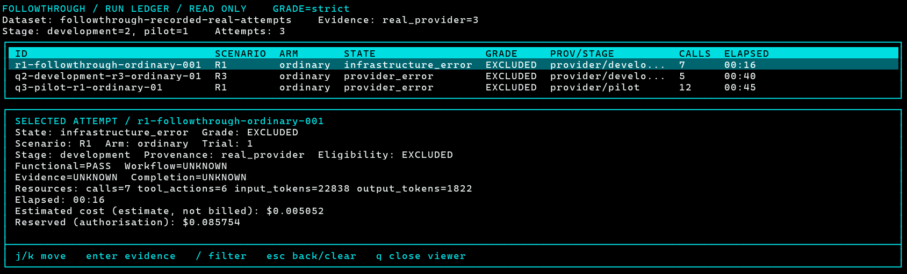
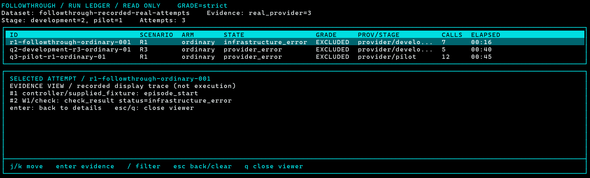
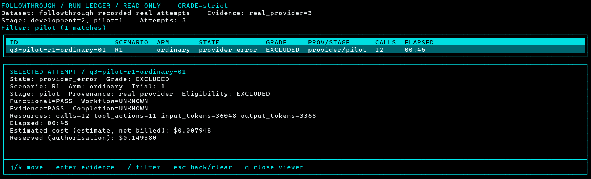
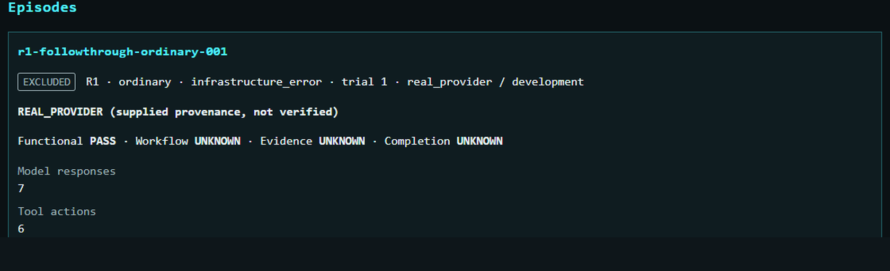
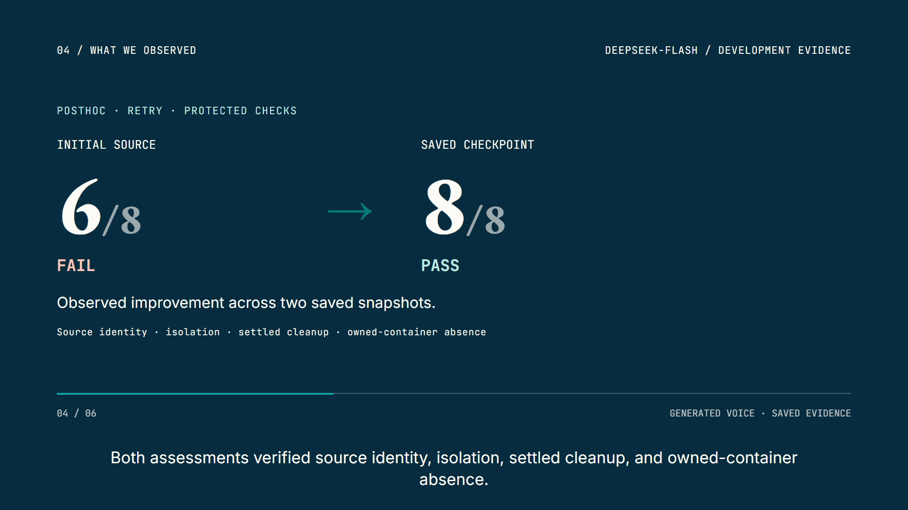
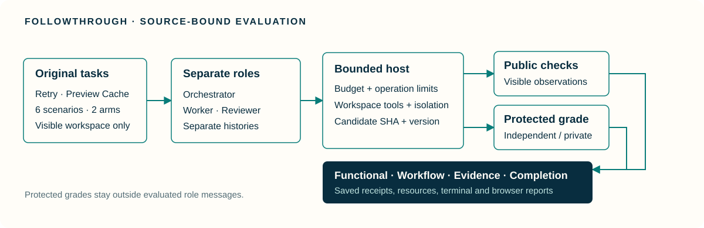

<h1 align="center">FollowThrough</h1>

<p align="center">
  <strong>A repair claim needs current evidence.</strong><br />
  Software repairs, role workflows, verification receipts and completion claims in one evaluation tool.
</p>

<p align="center">
  Built for the <a href="https://www.hackerrank.com/event/micro1-eval-hackathon">micro1 Eval Hackathon 2026</a><br />
  Software-repair evaluation · By Desan Vasu
</p>

<p align="center">
  <a href="https://desanv01.github.io/FollowThrough/"></a>
  
  <a href="https://github.com/desanv01/FollowThrough/actions/workflows/ci.yml"></a>
  <a href="LICENSE"></a>
</p>

<p align="center">
  <a href="#features">Features</a> ·
  <a href="#demo">Demo</a> ·
  <a href="https://desanv01.github.io/FollowThrough/">Watch video</a> ·
  <a href="#get-started">Get started</a> ·
  <a href="#deepseek--bounded-execution">DeepSeek &amp; execution</a> ·
  <a href="#documentation">Documentation</a>
</p>

<p align="center">
  <a href="https://desanv01.github.io/FollowThrough/"></a>
  <br /><sub>Actual CLI rendering · recorded provider-backed attempts, replayed for inspection.</sub>
</p>

## Why FollowThrough

A coding agent can repair a program and still rely on an old check, skip an independent review, or claim more than its evidence supports. A single pass/fail score hides those differences.

FollowThrough keeps the repaired source, its requirement version and the evidence behind each claim inspectable. It evaluates functional correctness, workflow adherence, verification currency and completion separately, while retaining infrastructure and provider failures as distinct outcomes.

**Domain focus:** software maintenance, transactional data integrity and cache correctness. The two original task families turn practical repair and verification concerns into executable cases: interrupted retry processing and preview caching after requirements change. [Task examples and rationale →](docs/project/TASK-EXAMPLES.md)

## Features

<table>
<tr>
<td width="50%" valign="top">

### Separate the four outcomes

Inspect functional, workflow, evidence and completion judgments together. An independent functional pass remains visible even when the overall episode is excluded.

</td>
<td width="50%" valign="top">

### Bind checks to current source

Candidate SHA-256 and requirement versions identify what a public check, review or protected grade actually covered. Stale evidence cannot silently become current verification.

</td>
</tr>
<tr>
<td width="50%" valign="top">

### Exercise six scenarios

R1/R2/R3 cover Retry; C1/C2/C3 cover Preview Cache. Ordinary and structured-progress arms share the same task requirements, including changed requirements and authored stale receipts.

</td>
<td width="50%" valign="top">

### Keep grading independent

Evaluated roles receive visible workspace files and public checks. Trusted functional grading runs separately against the identified candidate and requirement version.

</td>
</tr>
<tr>
<td width="50%" valign="top">

### Inspect a terminal run ledger

Navigate the dark/cyan T3 ledger, filter attempts, open saved evidence and inspect resource accounting. Text and JSON modes support non-interactive use.

</td>
<td width="50%" valign="top">

### Export reviewable records

Generate JSON, CSV and Markdown reports plus a portable read-only browser view. Estimates, reservation allowances, exclusions and unknowns retain separate labels.

</td>
</tr>
</table>

## Demo

**[Watch the narrated 4:45 walkthrough →](https://desanv01.github.io/FollowThrough/)** · [MP4 and captions](https://github.com/desanv01/FollowThrough/releases/tag/walkthrough-2026-11-09)

The included saved-report input contains three actual DeepSeek-backed attempts. Opening the viewer makes no fresh model request and runs no candidate code.

1. Open the actual T3 ledger and select an attempt with `j/k` or the arrows.
2. Inspect all four outcome dimensions and the attempt's resource fields.
3. Press `Enter` to inspect saved evidence, or `/` to filter by episode ID, scenario, arm or status.
4. Compare the same records in the portable browser report.
5. Reproduce the authored grader controls and inspect the retained model-output artifacts.

<table>
<tr>
<td width="50%" valign="top">
  <a href="docs/assets/demo/evidence.png"></a>
  <p><strong>Evidence beside the outcome.</strong> Inspect the recorded events supporting a selected attempt.</p>
</td>
<td width="50%" valign="top">
  <a href="docs/assets/demo/filter.png"></a>
  <p><strong>A focused terminal view.</strong> Filter the retained records without triggering execution.</p>
</td>
</tr>
<tr>
<td width="50%" valign="top">
  <a href="docs/assets/demo/browser.png"></a>
  <p><strong>The same saved evidence.</strong> A portable browser report requires no account or provider access.</p>
</td>
<td width="50%" valign="top">
  <a href="docs/assets/demo/trajectory.png"></a>
  <p><strong>An observed repair trajectory.</strong> Two actual saved states were independently assessed posthoc: <strong>6/8 → 8/8</strong>. This is not exact onset or a causal workflow comparison. <a href="docs/research/OBSERVED-R1-TRAJECTORY.md">Inspect the source-bound assessment →</a></p>
</td>
</tr>
</table>

[Capture provenance and attribution →](docs/assets/demo/README.md)

## Get started

### Open the free recorded-results demo

You need **Python 3.11+**, Git or the source ZIP, and a supported interactive terminal. The saved-results demo uses the Python standard library: no API key, Docker, paid credits or package installation is required.

```powershell
git clone https://github.com/desanv01/FollowThrough.git
cd FollowThrough
python -B -m reporting.run_ledger --input docs/research/recorded-development-input.json --format tui
```

Use `j/k` or arrows to select, `Enter` for evidence, `/` to filter, `Esc` to return and `q` to close. For logs or an unsupported interactive terminal, use `--format text` or `--format json`.

### Run the authored grading controls

```powershell
python -B grader/retry_processing.py --self-test
python -B grader/preview_cache.py --self-test
```

These execute the trusted original fixtures and their intentional defects. Their output distinguishes functional failures, candidate execution errors and infrastructure errors. Evaluated candidate code uses the isolated execution path; the recorded viewer never executes it.

### Generate a saved report

Use a fresh output directory:

```powershell
python -B -m reporting.report --input docs/research/recorded-development-input.json --output-dir runs/recorded-report
```

[Clean setup, browser-viewer command and judging walkthrough →](docs/release/TESTING.md)

## DeepSeek & bounded execution

The adapter calls the official DeepSeek API through separate role histories, exact pre-dispatch reservations and bounded operation limits. The recorded requested and returned alias is **`deepseek-flash`**; no immutable provider model snapshot is inferred from that alias.

Credentials remain in an ignored trusted local environment file. A canonical ledger preserves reservation history across operations, and source/run/version bindings keep public checks and protected grades associated with the intended candidate. Docker provides the isolated candidate runtime; the explicit Python public-check backend has native positive and negative control evidence. [Native controls →](docs/research/NATIVE-CONTROLS-2026-11-09.md)

Fresh provider execution requires separately configured credentials, qualified runtime access, a reviewed operation gate and budget authorization. See the [evaluation guide](docs/project/QUALIFIED-EVALUATION.md), [Python backend](docs/project/PYTHON-CHECK.md) and [live driver](docs/project/LIVE-DRIVER.md). No key, private ledger or raw private conversation is shipped in the repository.

## Recorded results

All three retained attempts received independent functional passes. The original episode was excluded after a public-check infrastructure error; the two later attempts were excluded after invalid provider content. These are development/incomplete-pilot observations, not a frozen formal study or evidence of a coding-capability failure. [Results, resources and exact limitations →](docs/research/DEVELOPMENT-RUNS-2026-11-09.md)

The [recorded output bundle](docs/research/recorded-outputs/README.md) includes saved parsed model actions, actual candidate source, raw public-check output, model aliases and source hashes. Exact provider wire responses and the rejected final payloads were not retained; the bundle identifies this boundary explicitly.

## Built with

| Interface | Evaluation & grading | Runtime & accounting | Model access |
|---|---|---|---|
| Python terminal ledger · portable HTML report | Python 3.11 · original Retry and Cache fixtures | Rust controller · Docker · SQLite reservation ledger | Official DeepSeek API · strict JSON-action protocol |

Hosted source CI runs on Ubuntu and Windows. Source packaging records the exact commit, Git tree, ZIP digest and tracked-file inventory. [Scoped delivery records →](docs/release/DELIVERY.md)

## Architecture



<p align="center"><sub>Original architecture illustration · model actions, trusted checks and outcome judgments remain distinct.</sub></p>

## Scope and contributions

The contribution to **micro1 Eval Hackathon 2026** is the original Retry and Preview Cache task/grader design, six scenario packages, bounded role/provider/runtime integration, source-version evidence binding and inspectable terminal/browser reports, developed on **7–9 November 2026**. No previous implementation, employer/client data or unrelated project fixture was copied into the tasks. Codex and human-launched DeepSeek harness workers assisted implementation with separate review. [Dated contribution ledger →](docs/release/CONTRIBUTIONS.md)

**Desan Vasu** · Software-repair evaluation and agent-workflow verification. The video and included records show the actual supported inspection and grading paths; exact observed results and their provenance boundaries remain linked above. No professional tenure or external credential is claimed.

## Documentation

- [Setup and testing](docs/release/TESTING.md)
- [Task examples](docs/project/TASK-EXAMPLES.md) and [scenario packages](docs/project/SCENARIOS.md)
- [Methods](docs/research/METHODS.md) and [outcome definitions](docs/project/OUTCOME-PREDICATES.md)
- [Recorded development evidence](docs/research/DEVELOPMENT-RUNS-2026-11-09.md)
- [Terminal ledger](docs/project/RUN-LEDGER.md) and [browser viewer](docs/project/VIEWER.md)
- [Contribution and prior-work attribution](docs/release/CONTRIBUTIONS.md)

## Feedback

[Open an issue](https://github.com/desanv01/FollowThrough/issues) with the expected behavior and reproducible steps. Keep credentials and private documents out of public reports.

## License

Original FollowThrough code and documentation are [MIT licensed](LICENSE). Dependencies and other third-party material retain their own rights and terms; see [NOTICE](NOTICE). The owner changed the project licence before submission; the approved video retains the earlier AGPL licence card, which describes its recorded snapshot.
